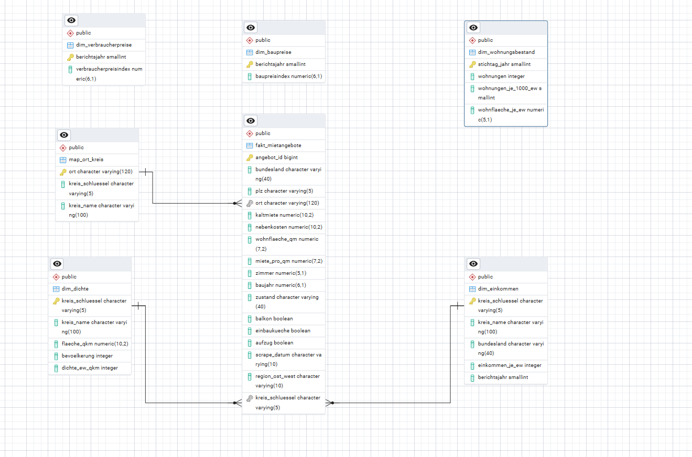
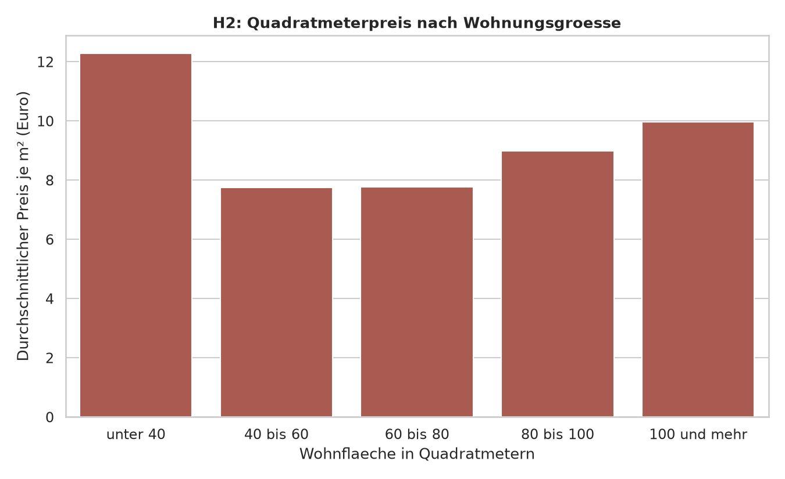
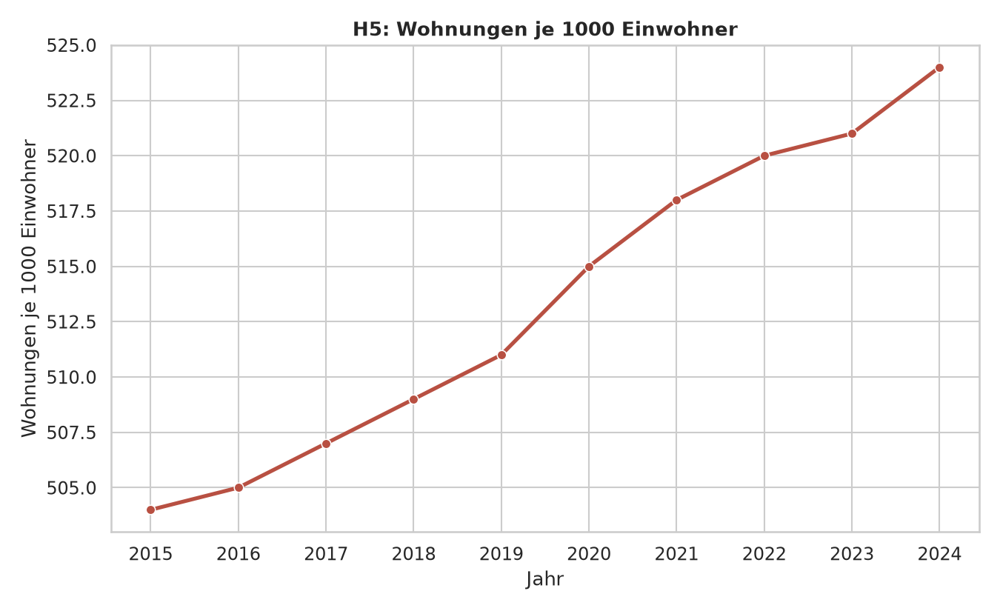
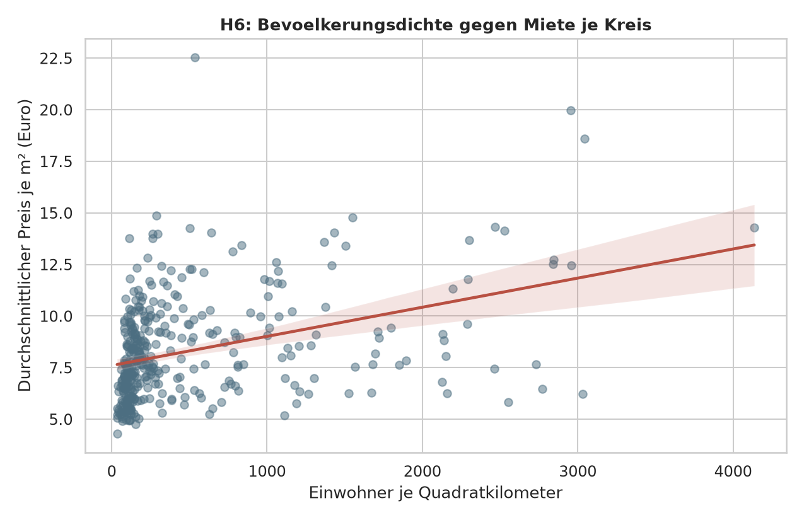
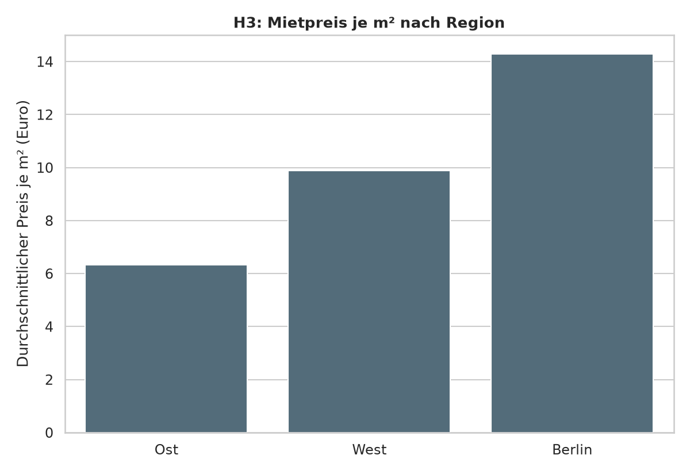

# Wohnungsmarktanalyse: Mietpreise in Deutschland

Abschlussprojekt meiner Data-Analyst-Weiterbildung am Data Science Institute (2026),
Teamprojekt zu dritt. Leitfrage: Welche Faktoren bestimmen die Mietpreise in Deutschland,
wie groß ist das regionale Gefälle, und wo ist Wohnen im Verhältnis zum Einkommen noch
bezahlbar? Dazu haben wir rund 268.000 Mietinserate mit fünf amtlichen Statistiken
verknüpft und sieben Hypothesen geprüft.

## Mein Anteil

Ich war im Team für das **Data Engineering** zuständig:

- Beschaffung und Bewertung der Datenquellen
- Aufbereitung aller Rohdaten mit Python, die Mietdaten mit PySpark (`python/01` bis `07`)
- Datenbank in PostgreSQL 17 als Sternschema, Verknüpfung über den Kreisschlüssel,
  Fremdschlüssel und ER-Diagramm (`sql/01`, `sql/09`, `sql/10`)
- Analyse-Abfragen als Ausgangspunkt für alle sieben Hypothesen (`sql/02` bis `08`)
- Docker-Setup mit Datenbank, pgAdmin und Python-Umgebung (`wohnungsmarkt-docker/`)
- Visualisierung aller Hypothesen mit seaborn direkt aus der Datenbank

Zusätzlich habe ich die Hypothesen **H2, H5 und H6** ausgewertet und präsentiert.
Die übrigen Hypothesen und das Dashboard haben die anderen beiden Teammitglieder übernommen.

## Daten

| Quelle | Inhalt | Für |
|---|---|---|
| Kaggle, „Apartment rental offers in Germany“ (ImmobilienScout24) | ca. 269.000 Mietinserate, vier Stichtage 09/2018 bis 02/2020 | H1, H2, H3 |
| VGRdL, Statistik 82411 | verfügbares Einkommen je Einwohner und Kreis (2019) | H4 |
| Destatis GENESIS 31231-0001 | Wohnungsbestand Deutschland 2015 bis 2024 | H5 |
| Destatis Gemeindeverzeichnis, Tabelle 04-kreise | Fläche, Bevölkerung und Dichte je Kreis | H6 |
| Destatis GENESIS 61261-0001 und 61111-0001 | Baupreisindex Wohngebäude und Verbraucherpreisindex 2021 bis 2025 | H7 |

Nach der Bereinigung blieben 268.176 Inserate. Eine selbst erstellte Zuordnungstabelle
(419 Einträge) verbindet jeden Ort aus den Mietdaten mit seinem amtlichen Kreisschlüssel.

Die Daten selbst liegen nicht im Repository. Die Mietdaten stammen von einer privaten
Plattform, die amtlichen Daten lassen sich über die Statistikportale frei herunterladen.

## Datenmodell



In der Mitte steht die Faktentabelle `fakt_mietangebote`. Über den Kreisschlüssel ist sie
mit Einkommen und Dichte verbunden, über den Ort mit der Zuordnungstabelle `map_ort_kreis`.
Bestand, Baupreise und Verbraucherpreise sind bundesweite Zeitreihen und hängen deshalb
nicht über einen Schlüssel an den Mieten. Verknüpft wird auf Kreisebene statt nach
Bundesland, weil das für H6 rund 400 statt 16 Datenpunkte ergibt.

## Ergebnisse

| | Hypothese | Ergebnis |
|---|---|---|
| H1 | Die teuersten Städte liegen deutlich über dem Bundesschnitt | bestätigt: München rund 165 % darüber, das Umland zieht mit |
| H2 | Kleine Wohnungen sind pro m² teurer | teilweise: U-Form, unter 40 m² über 12 €, 40 bis 80 m² knapp unter 8 €, große Wohnungen rund 10 € |
| H3 | Das Ost-West-Gefälle besteht fort | bestätigt: Osten gut 6 €, Westen knapp 10 €, Berlin mit über 14 € separat ausgewertet |
| H4 | Wohnen ist in vielen Städten kaum bezahlbar | Zusammenhang sichtbar: Kreise mit höherem Einkommen haben höhere Mieten (siehe Grenzen) |
| H5 | Der Wohnungsbestand wächst langsamer als die Bevölkerung | widerlegt: 504 auf 524 Wohnungen je 1.000 Einwohner (2015 bis 2024) |
| H6 | Die Bevölkerungsdichte erklärt die Preisunterschiede | teilweise: dichtere Kreise sind tendenziell teurer, die Streuung ist aber groß |
| H7 | Baupreise steigen schneller als die Verbraucherpreise | bestätigt: seit 2021 Baupreise +34 %, Verbraucherpreise +18 % |

Zusammengenommen spricht vieles dafür, dass Deutschland beim Wohnraum weniger ein
Mengenproblem als ein Verteilungsproblem hat: Bundesweit ist der Bestand pro Kopf
gewachsen, die Preise unterscheiden sich regional aber stark.

| | |
|---|---|
|  |  |
|  |  |

Alle sieben Diagramme liegen im Ordner `images/`.

## Grenzen der Analyse

- Es sind **Angebotsmieten** aus Inseraten, keine gezahlten Mieten oder Bestandsmieten.
  Sie liegen über dem tatsächlichen Mietniveau.
- Die Mietdaten stammen aus vier Stichtagen 2018 bis 2020 und enden vor Corona,
  Energiekrise und Inflationsschub. Großstädte und gewerbliche Vermieter sind überrepräsentiert.
- **H4:** Die Hypothese nennt eine Mietbelastung von über 30 % des Einkommens. Die Abfrage
  stellt Miete und Einkommen je Kreis gegenüber, die Belastungsquote selbst wird nicht
  berechnet. Das Einkommen gilt je Einwohner, die Miete je Wohnung, beides lässt sich
  nicht direkt verrechnen.
- Die Bevölkerungsdichte stammt vom aktuellen Gebietsstand, nicht exakt aus 2019.

## Was ich dabei gelernt habe

Beim Import der 268.176 Inserate scheiterte die Datenbank zunächst an Kleinigkeiten:
Spark schrieb das Baujahr als `1980.0`, was eine Ganzzahl-Spalte ablehnte, und fehlende
Nebenkosten als Text `NA`. Das Baujahr fängt jetzt eine NUMERIC-Spalte auf, die `NA`-Werte
habe ich direkt im Spark-Skript in echte Leerwerte umgewandelt. Außerdem hat uns
ein erneuter Lauf des Anlege-Skripts mit `DROP TABLE IF EXISTS` einmal vier gefüllte
Tabellen geleert. Seitdem wird das Skript nur einmal ausgeführt und danach nur noch
blockweise.

## Projektstruktur

```
python/                 Aufbereitung der Rohdaten (01 bis 07)
sql/                    Tabellen, Analysen H1 bis H7, Kontrollabfrage, Fremdschlüssel
wohnungsmarkt-docker/   Docker-Setup mit eigener Anleitung
images/                 ER-Diagramm und Diagramme H1 bis H7
rohdaten/, clean/       leer, hier landen die Daten beim Nachbauen
```

## Selbst nachbauen

1. Die Quellen aus der Tabelle oben herunterladen und in `rohdaten/` ablegen
2. Die Skripte `python/01` bis `07` nacheinander ausführen, sie schreiben nach `clean/`
   (`02` braucht PySpark)
3. In PostgreSQL 17 `sql/01_tabellen_anlegen.sql` ausführen und die CSVs aus `clean/`
   importieren (Trennzeichen Semikolon, UTF-8), danach `sql/10_fremdschlüssel_erd.sql`
4. Analysen mit `sql/02` bis `08`

Alternativ startet `wohnungsmarkt-docker/` Datenbank, pgAdmin und die Python-Umgebung
in Containern. Dafür wird ein eigenes Datenbank-Backup gebraucht, siehe Anleitung dort.

## Werkzeuge

Python (pandas, openpyxl, PySpark, seaborn, SQLAlchemy), PostgreSQL 17, pgAdmin, Docker
